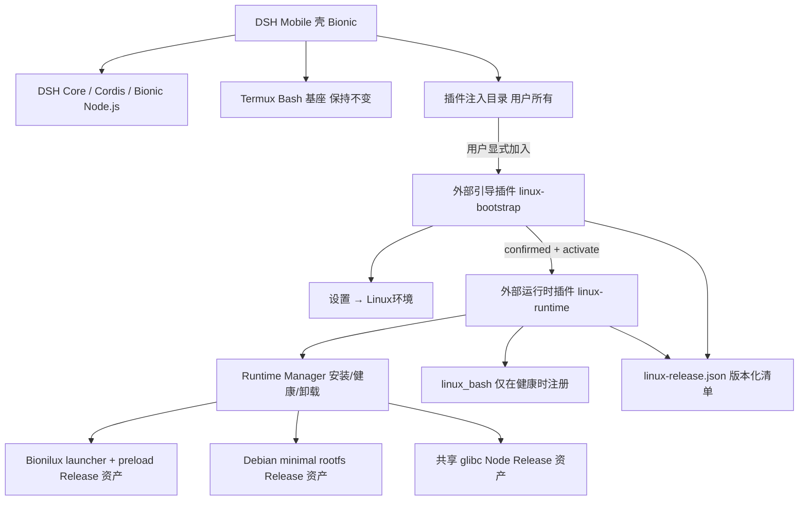
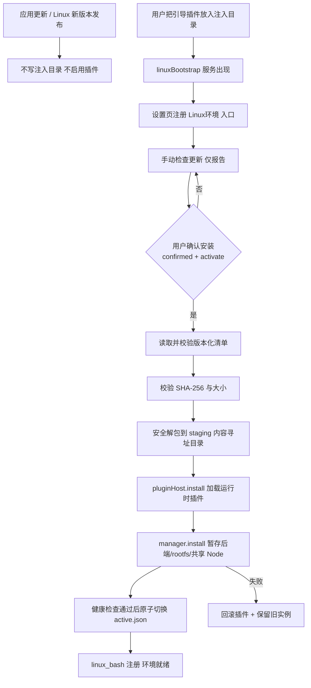
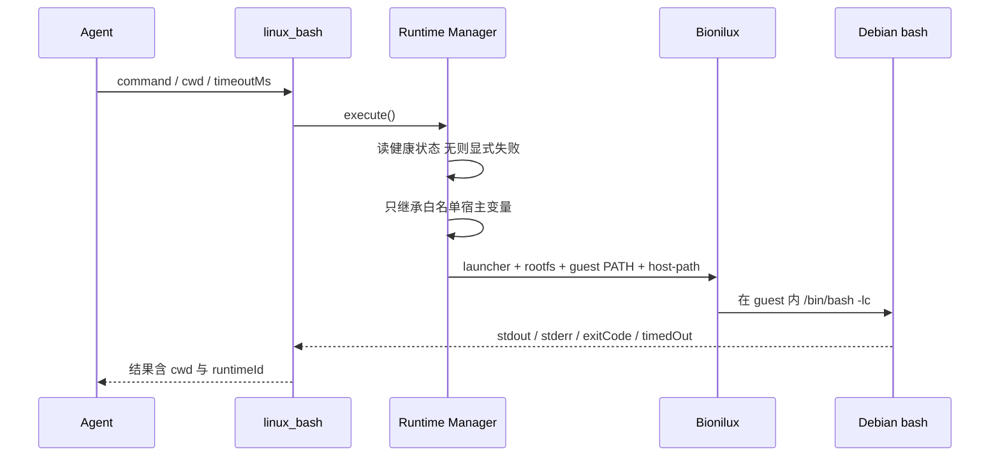
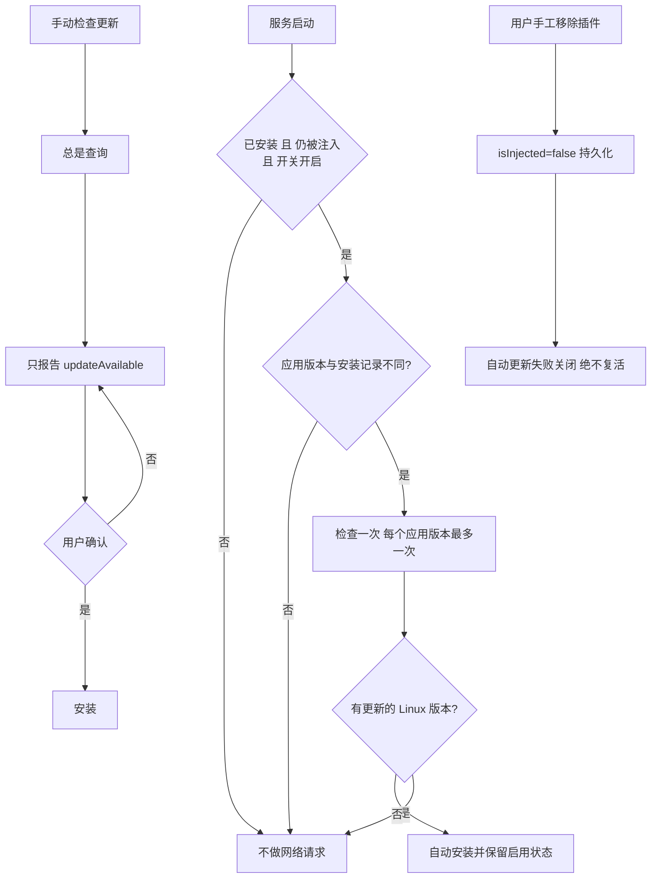

# PLUGINS — 挂载、安装与运行设计

本文件是本轮实现的**设计记录**：两个外部插件的边界、安装/启用流程、挂载与执行路径、
更新策略，以及“默认不启用”不变量。图与代码一一对应；实现细节见
[RELEASES.md](RELEASES.md) 与两个包的 README。

## 1. 组件与边界

* **host** 是 Android/壳（Bionic、应用私有目录）；**guest** 是 Debian 用户空间。
* `linux-release.json`、rootfs、Node、Bionilux 全部是 **Release 附件**，不进 Git、不进 LFS。
* 壳只提供 `linuxPluginHost` 适配器（加载/卸载插件目录、`isInjected`），不复制下载与解包事务。

## 2. 安装与启用（默认不启用）

**不变量**：`K` 之前不存在任何 Linux 工具；`G` 是唯一启用路径；`A` 永不触发 `G`。

## 3. 挂载与执行

* “挂载”分两层：**插件装配**（由壳的注入目录决定）与 **guest 路径映射**（`--host-path` 原路径直通，
  不做内核 bind mount）。
* 工作目录规则：rootfs 内的路径映射为 guest 路径；**guest 命名空间之外**且宿主上确实存在的目录
  按原名直通可见；位于 guest 命名空间内（`/etc`、`/usr`、`/tmp` …）或宿主上不存在的路径一律按
  guest 语义处理——因为 launcher 会先按名解析已配置的宿主目录，把这些目录提升为直通会遮蔽
  guest 自己的同名子树。
* 共享 glibc Node 位于各 rootfs 之外，经 `BIONILUX_HOST_PATHS` 与 guest `PATH` 暴露，
  从而“一份 Node 多环境复用”。
* guest 路径缺失按 guest 语义失败，**绝不**回落到宿主同名路径；Linux 失败也**绝不**回退 Termux。

## 4. 两个 Bash 的区别（面向 Agent）

| 项目 | Termux Bash（既有） | Linux Bash（本系统） |
|---|---|---|
| 执行环境 | Android/Bionic 宿主 | Debian/glibc guest 用户空间 |
| 软件包 | Termux 包与 PREFIX | Debian `apt`/`dpkg` |
| Node.js | 宿主 Bionic Node | 共享 glibc Node（应用级一份） |
| 用途 | 手机侧任务、宿主路径 | 需要 Debian/glibc 的任务 |
| 失败策略 | 原链路不变 | 显式报错，不静默切换 |

rootfs 提供的是**运行环境支持**，不是安全沙箱；guest root 是用户态身份，不等于 Android root。

## 5. 更新策略（独立于应用发布）

* 自动更新默认**关闭**；开关本身不触发检查。
* 降级被拒绝；相同版本需走“重新安装”。
* 插件版本与 Linux 系统版本独立于 DSH Mobile 应用版本演进。

## 6. 未验证项

真机端到端安装与 `isInjected` 行为属集成方；x86_64 未构建未验证；PTY/长会话未验证；
Debian rootfs 未固定镜像快照哈希。见 [STATUS.md](STATUS.md) §11。
